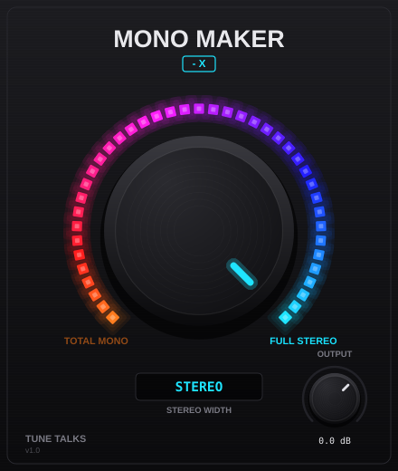

# Mono Maker - X — by Tune Talks

Plugin per il master (VST3 / AU / Standalone) che stringe il mix da **Full Stereo** a **Total Mono** e lo riapre, pensato per automazioni nei pre-drop.



## Controlli
| Controllo | Range | Note |
|---|---|---|
| **Stereo Width** (knob centrale con LED) | 0 % (Total Mono) → 100 % (Full Stereo) | Automatizzabile. Doppio clic = 100 %. |
| **Output** (knob in basso a destra) | −24 dB → +12 dB | Doppio clic = 0 dB. |

## Come funziona
Elaborazione Mid/Side: il Mid resta invariato, il Side viene moltiplicato per la Width.
A 0 % L e R diventano identici ((L+R)/2) → mono totale senza perdita di volume del centro.
A 100 % il segnale esce identico all'originale (bit-transparent con Output a 0 dB).
Width e Output hanno uno smoothing di 30 ms, quindi le automazioni non producono click.

## Uso tipico nel pre-drop
1. Inserisci Mono Maker - X come ultimo plugin sul master (prima del limiter, se vuoi che il limiter lavori sul segnale già stretto).
2. Nel DAW apri la lane di automazione **Stereo Width**.
3. Disegna una rampa da 100 % → 0 % nelle ultime 4–8 battute prima del drop, poi uno scatto a 100 % sul primo beat del drop.

## Compilazione
Serve CMake ≥ 3.22 e un compilatore C++17 (Xcode su Mac, Visual Studio 2022 su Windows). JUCE viene scaricato in automatico.

```bash
cmake -B build -DCMAKE_BUILD_TYPE=Release
cmake --build build --config Release
```

I plugin compilati si trovano in `build/MonoMakerX_artefacts/Release/`:
- **Mac**: copia `Mono Maker - X.vst3` in `~/Library/Audio/Plug-Ins/VST3/` e `Mono Maker - X.component` in `~/Library/Audio/Plug-Ins/Components/`
- **Windows**: copia `Mono Maker - X.vst3` in `C:\Program Files\Common Files\VST3\`

### Senza compilare in locale
Carica la cartella su un repository GitHub: il workflow in `.github/workflows/build.yml` compila in automatico le versioni Mac (Apple Silicon + Intel) e Windows, scaricabili dalla scheda **Actions**.

Su Mac, i plugin non firmati possono essere bloccati da Gatekeeper: `xattr -cr ~/Library/Audio/Plug-Ins/Components/"Mono Maker - X.component"`.
